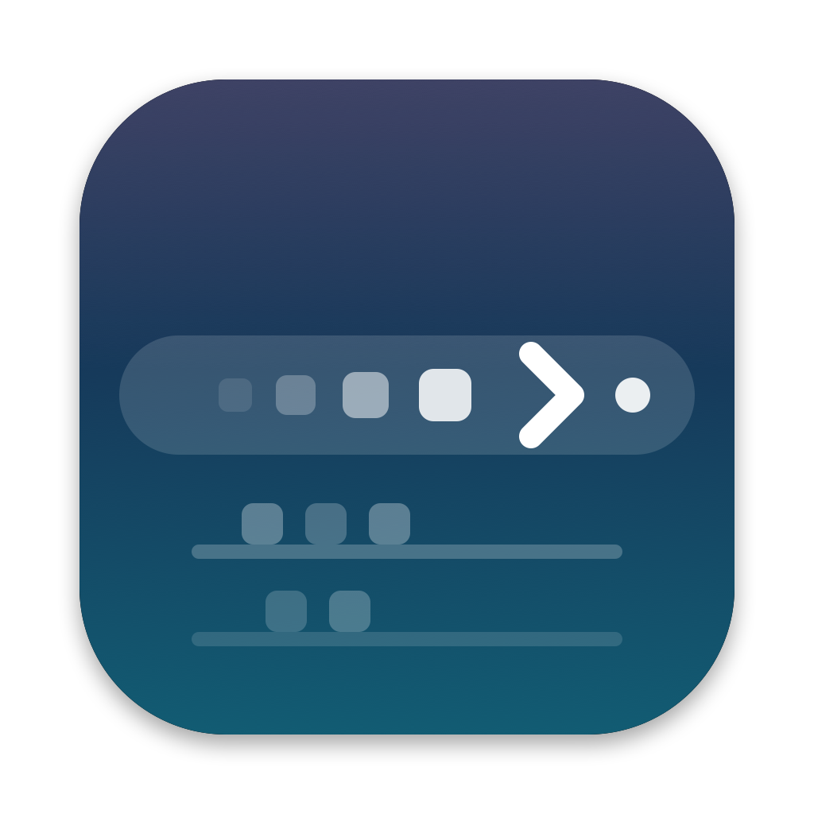

<p align="center"></p>

# Komora — hide menu bar icons on macOS 27

Komora is a small, open-source menu bar icon hider for **macOS 27**. It puts one
divider (`›`) in the menu bar. Click it, or press **⌥⌘B**, and every status icon
left of the divider disappears. Press again and they come back.

- **No Accessibility permission. No Screen Recording permission.** Komora only
  moves and measures its own status items.
- **No synthetic mouse events.** It never moves the pointer or clicks for you.
- **Works across displays.** Tested on two non-notched displays, one of them portrait.
- **One global shortcut**, ⌥⌘B by default, registered with Carbon `RegisterEventHotKey`.
- **About 600 lines of Swift**, no dependencies.

If you are looking for a Bartender, Ice, Hidden Bar, Dozer or Pelmet alternative
that works with the macOS 27 menu bar, this is one.

> **Status: 0.1.0, early.** Built and tested on one Mac: macOS 27.0.1 (26A434),
> Mac mini M4 Pro, two displays without a notch. There, a probe run hid every
> icon left of the divider on both displays, read through Accessibility. The
> app's own check passes on the current build (`verified=true`); earlier
> builds failed it after a ⌘-drag, see [how it works §7](docs/how-it-works.md#7--drag-pins-items).
> There is no screenshot yet.
> The mechanism depends on how macOS 27 lays out the menu bar. It is not
> verified on other macOS versions or on notched MacBook displays. See [Limitations](#limitations).

## Why another menu bar hider

On macOS 27 the menu bar is drawn by the system (MenuBarAgent). The classic
trick — one status item that grows very long and pushes icons off screen — no
longer works: according to Pelmet's notes, macOS refuses a length past about
half the display width. When the bar is too full, macOS instead moves the
**leftmost** items out of the bar.

Pelmet 0.10 uses that overflow with invisible spacers. On this Mac its spacers
landed left of all the icons, so on collapse macOS overflowed the spacers and
the icons stayed visible ([research/logs/e8.log](research/logs/e8.log)).

Komora fixes the order. An app can set where its **own** item appears by
writing `NSStatusItem Preferred Position <autosaveName>` in its own defaults
before it registers the item. A bigger value sits further left. On collapse
Komora creates "pusher" items with values just above the divider's value. They
land directly left of the divider, and their length pushes everything further
left out of the bar. Full write-up: [docs/how-it-works.md](docs/how-it-works.md).

## Install

There is no notarized release yet. Build from source:

```sh
git clone https://github.com/KYONY/komora.git
cd komora
./scripts/build-app.sh          # swift build -c release + ad-hoc signed bundle
cp -R build/Komora.app /Applications/
open /Applications/Komora.app
```

You need Xcode or the Command Line Tools with Swift 5.9 or later. To start
Komora at login, add it in System Settings → General → Login Items.

If you run another menu bar hider, quit it first. Two hiders fight over the
same bar, and both may react to ⌥⌘B.

## Use

| Action | Result |
|---|---|
| Click `›` | Hide every icon left of the divider. The glyph becomes `‹`. |
| Click `‹` | Show them again. |
| ⌥⌘B | Same toggle, from anywhere. |
| Right-click or ⌃-click the divider | Menu: hide/show, move the divider one icon left or right, shortcut status, last-collapse check, quit. |
| ⌘-drag the divider | Move it. Komora adopts the new spot on the next collapse. |

Hidden icons are out of the bar while collapsed. macOS may show a « item for
them; whether you can open hidden icons from it is not tested yet. Expand to
use them.

More: [docs/usage.md](docs/usage.md) — shortcut override, URL scheme,
state file, log.

## Limitations

- Built and tested on macOS 27.0.1 only. Package.swift declares macOS 14, but
  nobody has built or run it there, and the hiding mechanism needs macOS 27's
  left overflow.
- Not tested on a display with a notch.
- Not tested yet: wake from sleep and display reconfiguration while collapsed
  (the code handles both).
- Ad-hoc signed. Gatekeeper may ask you to confirm the first launch.
- Komora cannot read other apps' icons (that would need Accessibility). It
  checks its own items only: after a collapse its pushers must form an unbroken
  chain to the divider. The menu shows the result.

Problems and fixes: [docs/troubleshooting.md](docs/troubleshooting.md).

## Documentation

- [How it works](docs/how-it-works.md) — the seeded position key, pushers, sizing, the ⌘-drag pin.
- [Usage](docs/usage.md) — controls, shortcut, URL scheme, files.
- [Troubleshooting](docs/troubleshooting.md)
- [Research notes](docs/research.md) — every experiment, what it showed, what did not work.
- [Building and contributing](CONTRIBUTING.md)
- [Changelog](CHANGELOG.md)

## Credits

- The pusher sizing (half the narrowest display minus 64 pt) follows
  [Pelmet](https://github.com/ismatBabirli/pelmet) 0.10 (MIT). No Pelmet code is copied.
- No code from Ice (GPL) is used.

## License

[MIT](LICENSE)
